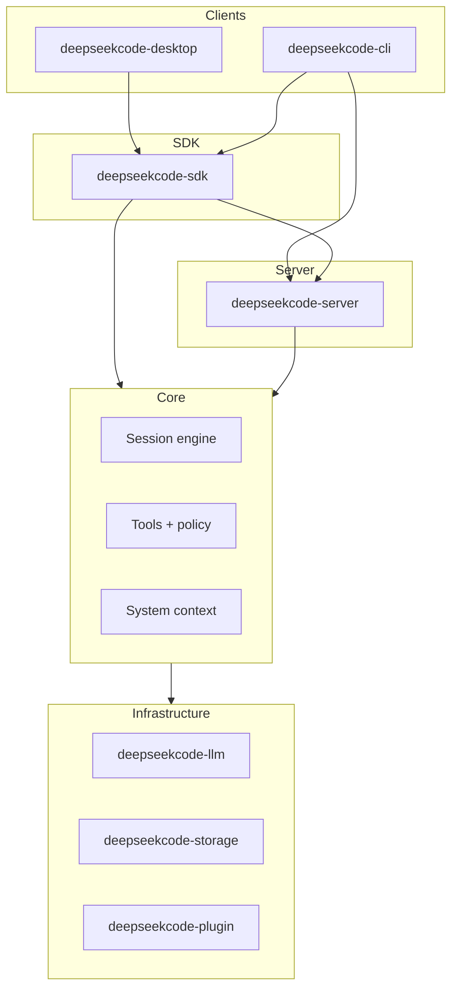

## Goals

DeepSeekCode is a Rust-native AI programming environment:

- **Session-driven agent** with tools, policy, file/terminal/diff review, multi-provider LLM
- **Embeddable SDK** (`deepseekcode-sdk`) shared by desktop, CLI, and future clients
- **GPUI desktop shell** with in-process Axum server + SSE (low latency vs sidecar)

## Layered architecture

| Layer | Crate | Role |
|-------|-------|------|
| Types / schema | `deepseekcode-types`, `deepseekcode-schema` | IDs, errors, API shapes |
| Config | `deepseekcode-config` | `deepseekcode.jsonc`,  |
| Core | `deepseekcode-core` | Session runner, tools, policy, MCP |
| LLM | `deepseekcode-llm` | OpenAI / Anthropic / OpenRouter / DeepSeek |
| Storage | `deepseekcode-storage` | SQLite, events, encrypted credentials |
| Server | `deepseekcode-server` | HTTP `/api/v1/*`, SSE, OpenAPI |
| SDK | `deepseekcode-sdk` | `EmbeddedEngine`, HTTP client |
| API types | `deepseekcode-schema::api` | Single source of truth for HTTP shapes (SDK/server share; no hand-rolled `json!`) |
| Desktop | `deepseekcode-desktop` | GPUI UI |
| CLI | `deepseekcode-cli` | `serve`, `run`, session commands |

## Session runtime (summary)

Authoritative detail: [`specs/session-runtime.md`](../specs/session-runtime.md).

- Prompt admission inbox → promotion at safe provider-turn boundary
- Context epochs with `AGENTS.md` as context source
- Location-scoped services per project directory
- Policy engine: `permit` / `prompt` / `block` ([`specs/policy-system.md`](../specs/policy-system.md))

## Embedded vs standalone server

- **Desktop / SDK default**: bind `127.0.0.1`, engine in-process
- **CLI `serve`**: standalone HTTP server; set `DEEPSEEKCODE_SERVER_PASSWORD` when exposed beyond localhost ([`SECURITY.md`](../SECURITY.md))

## Performance smoke targets (local dev)

Benchmarks under `benches/` track rough targets:

| Benchmark | Target (indicative) |
|-----------|---------------------|
| `startup` | Embedded engine cold start < 2s |
| `sse_latency` | First SSE event < 50ms locally |
| `file_tree` | 10k-node listing < 200ms |
| `memory` | RSS after engine start (regression guard) |

Run: `cargo bench -p deepseekcode-sdk --bench startup`

## Known structural debts (tracked, phased)

- **SDK → server dependency**: `deepseekcode-sdk` currently depends on
  `deepseekcode-server` (Axum + PTY + core) for `EmbeddedEngine`, forcing
  desktop/CLI to link the full server. Phase-out: extract a
  `server-api-types`-only surface (done for DTOs via `schema::api`) and route
  `EmbeddedEngine` through it, leaving the Axum router to `serve`-only builds.
- **`wasmtime` compile cost**: `core → plugin → wasmtime 29` taxes even
  `run`/`serve` builds that never load WASM (~100MB). Phase-out: `plugin/wasm`
  cargo feature gate + engine pooling/fuel/memory limits + `.wasm` signature
  verification (`host.rs` currently accepts any instantiable module).
- **`dirs 6.0` (unmaintained)**: used by config/storage/CLI/desktop.
  Phase-out: migrate to `directories` with sandboxed fallbacks.
- **`sqlx` + `refinery` dual migration stacks**: kept because history files
  use refinery naming; the custom runner now enforces version order +
  fail-closed DDL. Long term: converge on one runner.

## Related docs

- [README.md](../README.md) — quick start
- [packaging.md](packaging.md) — release channels & signing
- [logging.md](logging.md) — observability
- [CONTRIBUTING.md](../CONTRIBUTING.md) — dev workflow
